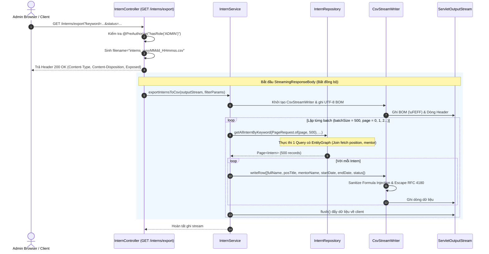

# Kế hoạch triển khai: Export CSV Thực tập sinh cho Admin (`GET /interns/export`)

Tài liệu này mô tả chi tiết kế hoạch kỹ thuật triển khai tính năng xuất file CSV danh sách thực tập sinh cho Admin, đáp ứng đầy đủ các yêu cầu về hiệu năng, bảo mật dữ liệu, chuẩn hóa định dạng và trải nghiệm người dùng.

---

## 1. Yêu cầu & Tiêu chí kỹ thuật

| STT | Hạng mục | Chi tiết yêu cầu | Giải pháp kỹ thuật |
| :--- | :--- | :--- | :--- |
| 1 | **Endpoint & Phân quyền** | `GET /interns/export`<br>Chỉ dành cho Admin | `@PreAuthorize("hasRole('ADMIN')")` tại `InternController.java` |
| 2 | **Bộ lọc tìm kiếm** | Tái sử dụng đồng nhất với API danh sách | Dùng trực tiếp bộ tham số `(keyword, status, start_date, end_date, position_id, mentor_id)` và truy vấn `getAllInternByKeyword` |
| 3 | **Định dạng Response** | Trả file trực tiếp, không bọc `ApiResponse` | `ResponseEntity<StreamingResponseBody>`<br>- `Content-Type: text/csv; charset=UTF-8`<br>- `Content-Disposition: attachment; filename="interns_yyyyMMdd_HHmmss.csv"` |
| 4 | **CORS Header** | Cho phép frontend đọc tên file từ header | Thêm `setExposedHeaders(List.of("Content-Disposition"))` vào `corsConfigurationSource()` tại `SecurityConfig.java` |
| 5 | **Các cột xuất (Admin)** | Tương ứng các cột trên bảng Intern Management | `Full name`, `Position`, `Mentor`, `Start date`, `End date`, `Status` |
| 6 | **Encoding & Hiển thị** | Đọc chuẩn tiếng Việt / tiếng Nhật trên Excel | Ghi **UTF-8 BOM** (`0xEF, 0xBB, 0xBF` / `\uFEFF`) ngay đầu stream |
| 7 | **Escape & An toàn dữ liệu** | Chuẩn RFC 4180 + Ngăn chặn CSV/Formula Injection | - Bọc `"...""` khi có dấu `,`, `"`, `\n`, `\r`. Nhân đôi `""`.<br>- Vô hiệu hóa ký tự bắt đầu bằng `=`, `+`, `-`, `@`, `\t`, `\r` (thêm tiền tố `'`) |
| 8 | **Tái sử dụng code** | Cả hai endpoint (Admin/Mentor) dùng chung 1 engine | Xây dựng generic `CsvStreamWriter` dùng chung, chỉ khác danh sách Header và Row Mapper |
| 9 | **Hiệu năng & Memory** | Tránh OOM khi dữ liệu lớn, tránh N+1 Query | - Streaming từng lô (`StreamingResponseBody`, `batchSize = 500`, `flush()` từng batch)<br>- Thêm `@EntityGraph` trên `getAllInternByKeyword` giải quyết N+1 cho `position`, `mentor`, `internshipBatch` |
| 10 | **Xử lý Transaction** | Tránh `LazyInitializationException` và giữ kết nối DB quá lâu | Xử lý transaction đọc theo từng lô (hoặc `@Transactional(readOnly = true)`) trước khi ghi ra stream |
| 11 | **Xử lý lỗi giữa chừng** | Không thể đổi HTTP status khi đã stream | Bắt lỗi, log cảnh báo rõ ràng và ngắt stream an toàn, không cố ghi JSON lỗi vào file CSV |

---

## 2. Kiến trúc & Thiết kế luồng xử lý (Architecture & Data Flow)



---

## 3. Các bước triển khai chi tiết

### Bước 1: Cấu hình CORS Expose Header trong `SecurityConfig`
- **File**: `com/rikai/backend/security/SecurityConfig.java`
- **Hành động**: Trong phương thức `corsConfigurationSource()`, thêm:
  ```java
  corsConfiguration.setExposedHeaders(List.of("Content-Disposition"));
  ```
- **Mục đích**: Cho phép frontend JavaScript trích xuất được `Content-Disposition` header để lấy tên file gốc được backend sinh theo timestamp `interns_yyyyMMdd_HHmmss.csv`.

---

### Bước 2: Xây dựng Bộ ghi CSV dùng chung (`CsvStreamWriter`)
- **File**: `com/rikai/backend/common/csv/CsvStreamWriter.java` (tạo mới trong package `common.csv`)
- **Thiết kế**:
  - Không cần cài thêm thư viện ngoài (tránh tăng dung lượng dependency và nguy cơ phụ thuộc bên thứ 3) vì logic CSV chuẩn RFC 4180 và phòng chống formula injection rất gọn gàng.
  - Hỗ trợ ghi UTF-8 BOM: `\uFEFF` (`0xEF, 0xBB, 0xBF`).
  - Hỗ trợ hàm format cell an toàn:
    ```java
    public static String sanitizeAndEscape(String value) {
        if (value == null) return "";
        // 1. Chống CSV Formula Injection: nếu bắt đầu bằng =, +, -, @, \t, \r
        if (value.startsWith("=") || value.startsWith("+") || value.startsWith("-") || 
            value.startsWith("@") || value.startsWith("\t") || value.startsWith("\r")) {
            value = "'" + value;
        }
        // 2. Escape chuẩn RFC 4180: nếu chứa dấu phẩy, dấu nháy kép hoặc xuống dòng
        if (value.contains(",") || value.contains("\"") || value.contains("\n") || value.contains("\r")) {
            value = "\"" + value.replace("\"", "\"\"") + "\"";
        }
        return value;
    }
    ```
  - Cung cấp phương thức `writeRow(List<String> values)` và `writeHeader(List<String> headers)`.
  - Phương thức generic `writeRecords(OutputStream out, List<String> headers, Function<T, List<String>> rowMapper, ...)` để các API khác (ví dụ: Export cho Mentor) tái sử dụng trực tiếp mà không lặp lại mã nguồn.

---

### Bước 3: Tối ưu hóa truy vấn tránh N+1 trong `InternRepository`
- **File**: `com/rikai/backend/repository/InternRepository.java`
- **Vấn đề hiện tại**: Phương thức `getAllInternByKeyword` truy vấn `SELECT i FROM Intern i...`. Khi lấy `i.getPosition()`, `i.getMentor()`, hoặc `i.getInternshipBatch()`, Hibernate sẽ phát sinh các câu lệnh SELECT đơn lẻ cho từng bản ghi (N+1 query problem).
- **Hành động**: Thêm `@EntityGraph` trực tiếp lên `getAllInternByKeyword`:
  ```java
  @EntityGraph(attributePaths = {"position", "mentor", "internshipBatch"})
  @Query("""
          SELECT i FROM Intern i
          WHERE (:keyword IS NULL OR :keyword = '' OR LOWER(i.fullName) LIKE LOWER(CONCAT('%', :keyword, '%')))
          AND (:internStatus IS NULL OR i.internStatus = :internStatus)
          AND (:startDate IS NULL OR i.startDate >= :startDate)
          AND (:endDate IS NULL OR i.startDate <= :endDate)
          AND (:positionId IS NULL OR i.position.id = :positionId)
          AND (:mentorId IS NULL OR i.mentor.id = :mentorId)
           """)
  Page<Intern> getAllInternByKeyword(...);
  ```
- **Lợi ích**:
  - Tái sử dụng chính xác 100% điều kiện lọc của API danh sách hiện tại.
  - Eager fetch toàn bộ các quan hệ cần thiết bằng `LEFT JOIN` trong 1 câu SQL duy nhất cho mỗi batch.
  - Tối ưu hóa luôn cả API danh sách hiện tại trên frontend.

---

### Bước 4: Khai báo Service Interface và Service Implementation
- **File**: 
  - `com/rikai/backend/service/intern/IInternService.java`
  - `com/rikai/backend/service/intern/InternService.java`
- **Đặc tả logic**:
  - Khai báo phương thức:
    ```java
    void exportInternsCsv(
        OutputStream outputStream,
        String keyword,
        String status,
        LocalDate startDate,
        LocalDate endDate,
        Long positionId,
        UUID mentorId
    );
    ```
  - Xử lý tham số `status` tương đồng với `getAllInterns` (kiểm tra `InternStatus.valueOf()`).
  - Thiết lập Header các cột: `["Full Name", "Position", "Mentor", "Start Date", "End Date", "Status"]`.
  - Phân trang đọc theo lô:
    - Kích thước lô: `batchSize = 500`.
    - Dùng vòng lặp `PageRequest.of(pageIndex, batchSize, Sort.by("id").ascending())`.
    - Gọi `outputStream.flush()` sau mỗi batch hoàn thành để đẩy dữ liệu xuống socket mạng, giải phóng RAM.
  - Quản lý Transaction: Phương thức thực thi với `@Transactional(readOnly = true)` để đảm bảo session Hibernate hợp lệ xuyên suốt các lần truy vấn batch.

---

### Bước 5: Endpoint Controller (`InternController`)
- **File**: `com/rikai/backend/controller/InternController.java`
- **Hành động**: Bổ sung endpoint:
  ```java
  @GetMapping("/export")
  @PreAuthorize("hasRole('ADMIN')")
  public ResponseEntity<StreamingResponseBody> exportInterns(
          @RequestParam(required = false, name = "keyword") String keyword,
          @RequestParam(required = false, name = "status") String status,
          @RequestParam(required = false, name = "start_date") LocalDate startDate,
          @RequestParam(required = false, name = "end_date") LocalDate endDate,
          @RequestParam(required = false, name = "position_id") Long positionId,
          @RequestParam(required = false, name = "mentor_id") UUID mentorId) {

      String timestamp = LocalDateTime.now().format(DateTimeFormatter.ofPattern("yyyyMMdd_HHmmss"));
      String filename = "interns_" + timestamp + ".csv";

      StreamingResponseBody responseBody = outputStream -> {
          try {
              internService.exportInternsCsv(outputStream, keyword, status, startDate, endDate, positionId, mentorId);
          } catch (Exception e) {
              log.error("Error streaming CSV export for interns", e);
              // Lưu ý: Không ném Exception ra ngoài để ghi ApiResponse JSON vì stream đã bắt đầu và status code 200 đã gửi đi.
          }
      };

      return ResponseEntity.ok()
              .header(HttpHeaders.CONTENT_TYPE, "text/csv; charset=UTF-8")
              .header(HttpHeaders.CONTENT_DISPOSITION, "attachment; filename=\"" + filename + "\"")
              .body(responseBody);
  }
  ```

---

## 4. Xử lý các tình huống đặc biệt & Ghi chú PR (Pull Request Notes)

Dưới đây là các luận điểm kỹ thuật được chuẩn bị sẵn để đưa vào mô tả Pull Request:

### 4.1. Lựa chọn kích thước lô (Batch Size = 500)
- **Lý do**: Kích thước 500 bản ghi là điểm cân bằng tối ưu giữa số lượng truy vấn database roundtrips và dung lượng bộ nhớ JVM.
- Với 10.000 thực tập sinh, hệ thống chỉ thực hiện 20 truy vấn SQL, mỗi lô tiêu tốn chưa đến vài trăm KB heap memory và được giải phóng ngay sau khi ghi và `flush()` ra `OutputStream`.

### 4.2. Giải pháp triệt để tránh N+1 Query
- Sử dụng `@EntityGraph(attributePaths = {"position", "mentor", "internshipBatch"})` trên phương thức `getAllInternByKeyword`.
- Hibernate sẽ sinh câu lệnh `SELECT ... FROM interns i LEFT JOIN positions ... LEFT JOIN users ...` trong cùng 1 query, thay vì thực hiện 1 query lấy danh sách intern rồi thêm N queries lấy từng position và mentor.

### 4.3. Quản lý phạm vi Transaction
- `StreamingResponseBody` chạy bất đồng bộ trong thread pool riêng (`MvcAsyncBiFunction` / `TaskExecutor`).
- Phương thức `exportInternsCsv` trong `InternService` được bọc bởi `@Transactional(readOnly = true)`. Nhờ vậy, session JPA luôn mở trong quá trình truy vấn dữ liệu theo lô, ngăn ngừa hoàn toàn lỗi `LazyInitializationException` khi truy cập các thuộc tính lazy (`internshipBatch`).

### 4.4. Xử lý lỗi giữa chừng (Mid-stream Error Handling)
- **Đặc thù HTTP**: Một khi `ResponseEntity<StreamingResponseBody>` bắt đầu ghi dữ liệu, HTTP Status `200 OK` và response header đã được gửi tới client.
- **Cách xử lý**: Nếu xảy ra lỗi giữa chừng (ví dụ rớt kết nối database hoặc client chủ động ngắt kết nối `ClientAbortException`):
  - Backend bắt exception, ghi log chi tiết (`log.error`).
  - Đóng `OutputStream` ngay lập tức để phía client nhận biết download bị gián đoạn (file không trọn vẹn).
  - Tuyệt đối không ghi thông báo lỗi dạng JSON hay chuỗi stacktrace vào output stream để tránh làm hỏng định dạng file của người dùng.

### 4.5. Quyết định về CORS & Header `Content-Disposition`
- Lựa chọn giải pháp: Cấu hình `setExposedHeaders(List.of("Content-Disposition"))` tại backend `SecurityConfig`.
- Nhờ vậy, frontend có thể linh hoạt đọc filename động (`interns_yyyyMMdd_HHmmss.csv`) trực tiếp từ response header mà không cần phải tự sinh tên file ở client-side.

### 4.6. Quyết định về thư viện CSV
- **Lựa chọn**: Tự xây dựng `CsvStreamWriter` nội bộ (~50 dòng code) thay vì thêm dependency `commons-csv`.
- **Lý do**: Yêu cầu định dạng CSV rất chuẩn xác (BOM UTF-8, escape RFC 4180 và sanitize Formula Injection). Việc tự hiện thực hóa giúp kiểm soát hoàn toàn quy tắc injection (`=`, `+`, `-`, `@`), không làm phình to `build.gradle`, và dễ dàng tái sử dụng cho các màn hình export khác trong tương lai.

---

## 5. Kế hoạch kiểm thử (Test Plan)

1. **Kiểm thử Unit & Integration**:
   - Viết test case trong `InternControllerTest` sử dụng `MockMvc`:
     - Kiểm tra phân quyền: Role `MENTOR` gọi `/interns/export` trả về `403 Forbidden`.
     - Role `ADMIN` gọi `/interns/export` trả về `200 OK`, header `Content-Type: text/csv; charset=UTF-8`, `Content-Disposition` chứa filename khớp regex `interns_\d{8}_\d{6}\.csv`.
2. **Kiểm thử hiển thị Tiếng Việt / Tiếng Nhật trên Excel**:
   - Xuất dữ liệu có tên tiếng Việt có dấu (`Nguyễn Văn A`) và tiếng Nhật (`田中 太郎`).
   - Mở trực tiếp bằng Microsoft Excel trên Windows để xác nhận không bị lỗi font (mojibake).
3. **Kiểm thử bảo mật CSV Injection**:
   - Tạo thực tập sinh có tên `=1+1`, `@SUM(A1:A10)`, `-100`, `+test`.
   - Xuất file CSV và mở trên Excel, đảm bảo các ô này hiển thị dạng text an toàn (tiền tố `'`) và không tự động thực thi công thức.
4. **Kiểm thử tái sử dụng bộ lọc**:
   - Tìm kiếm với `keyword="John"`, `status="ACTIVE"`, `position_id=1`.
   - Đối chiếu số lượng và danh sách trả về giữa API `GET /interns` và file CSV `GET /interns/export`.
